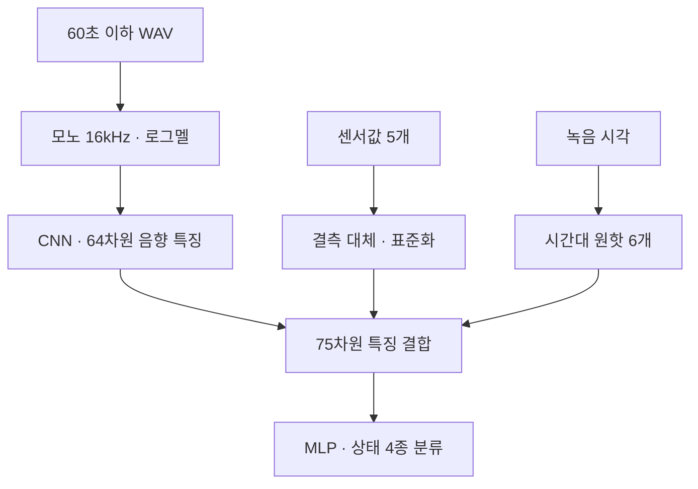
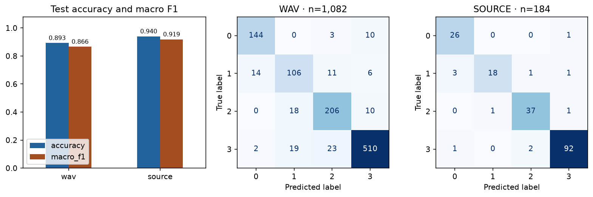

# 벌통 소리·환경 데이터 기반 여왕벌 상태 분류

> **프로젝트 보고서:** [보고서 보기 (PDF)](bee_project_report_redesigned.pdf)

벌통의 녹음과 온도·습도·기압을 함께 분석해 여왕벌 상태를 네 가지로 분류하는 딥러닝 프로젝트입니다. 음향 특징을 추출하는 CNN과 현재 환경값을 처리하는 MLP를 결합하고, Streamlit에서 장치 관측 JSON과 WAV 파일을 입력해 결과를 확인할 수 있도록 구현했습니다.

| 항목 | 내용 |
|---|---|
| 개발 기간 | 2026.11.02 ~ 2026.11.05 |
| 분야 | 오디오 분류, 멀티모달 딥러닝, 데이터 분할 실험, 추론 서비스 |
| 현재 서비스 모델 | 로그멜 CNN 인코더 + 환경·시간대 특징을 결합한 MLP |
| 주요 결과 | 메인 실행의 테스트 WAV 정확도 **89.28%**, 원본 녹음 단위 정확도 **94.02%** |
| 구현 범위 | 데이터 연결·EDA·전처리·학습·평가·모델 저장·Streamlit 배치 추론 |

## 1. 프로젝트 배경

벌통 내부를 자주 열어 확인하기 어려운 상황에서, 마이크와 환경 센서로 수집한 자료를 이용해 상태 변화를 관찰하는 방법을 실험했습니다. 소리만으로 분류하는 CNN에서 출발해 환경 정보를 결합하고, 데이터 분할 방식에 따라 평가 결과가 얼마나 달라지는지 비교했습니다.

최종 앱은 파일 입력을 이용하는 추론 시연입니다. 실제 벌통의 마이크·센서를 연결한 상시 수집이나 상태 변화 알림은 향후 확장 대상입니다.

## 2. 기술 스택

| 영역 | 기술 | 사용 목적 |
|---|---|---|
| 개발 | Python 3.12, Jupyter Notebook | 데이터 분석, 실험, 학습 과정 기록 |
| 딥러닝 | TensorFlow, Keras | CNN·MLP 및 비교용 CNN+LSTM 학습, 모델 저장·재로딩 |
| 오디오 | librosa, soundfile | WAV 읽기, 리샘플링, 로그멜 변환, 품질 수치 계산 |
| 데이터·평가 | NumPy, pandas, scikit-learn | 원본 연결, 전처리, 분할, 분류 지표 계산 |
| 시각화 | Matplotlib | EDA, 학습 곡선, 혼동행렬, 로그멜 시각화 |
| 서비스 | Streamlit | 여러 JSON/WAV 쌍의 배치 추론과 결과 확인 |
| 검증 | unittest, nbformat | 입력 검증, 전처리 일치, 노트북 구조 검사 |

패키지 범위는 [requirements.txt](requirements.txt)에 정리했습니다.

## 3. 데이터 구성

출처: [Kaggle · Smart Bee Colony Monitor: Clips of Beehive Sounds](https://www.kaggle.com/datasets/annajyang/beehive-sounds)

| 항목 | 로컬 데이터 기준 |
|---|---|
| 환경·라벨 CSV | 1,275행, 23열 |
| 음성 | 60초 WAV 7,100개 |
| 연결된 원본 관측 | 1,222개 |
| 벌통 | 4개: 1, 3, 4, 5 |
| 관측 시기 | 2022.06.05 ~ 2022.07.15 |
| 정답 | `queen status` 0~3 |

| 라벨 | 의미 | WAV 수 |
|---|---|---:|
| 0 | 기존 여왕벌 존재 | 1,038 |
| 1 | 여왕벌 없음 | 946 |
| 2 | 새 여왕벌 거부됨 | 1,553 |
| 3 | 새 여왕벌 수용됨 | 3,563 |

하나의 원본 관측에 여러 WAV 조각이 연결됩니다. 파일명의 `__segmentN` 앞부분으로 `source_id`를 만들고 CSV와 연결했습니다. 같은 원본의 조각들이 학습과 테스트에 나뉘지 않도록 **원본 관측을 먼저 분할한 뒤 WAV를 배정**합니다.

환경 입력은 벌통 온도·습도·기압, 외기 온도·기압의 다섯 가지입니다. 정답과 직접 관련된 `target`, `queen presence`, `queen acceptance`는 입력에서 제외했습니다. 월 역시 입력에서 제외했지만, 시간적으로 가까운 관측의 유사성은 남으므로 별도 분할 실험으로 확인했습니다.

자세한 컬럼 사전과 데이터 연결 규칙은 [데이터셋 설명](docs/DATASET_DESCRIPTION.md)을 참고하세요.

## 4. 처리 흐름과 모델



**로그멜 스펙트로그램**은 소리를 시간에 따른 주파수별 에너지 분포로 바꾼 것입니다. 사람의 청각 특성을 반영한 멜 주파수축과 로그 크기를 사용해, CNN이 소리의 패턴을 이미지처럼 학습하도록 했습니다.

- WAV는 모노 16kHz로 변환하고 60초에 맞춰 패딩합니다. 로그멜은 `n_mels=64`, `n_fft=1024`, `hop_length=512`로 계산하며 입력 크기는 `(64, 1876, 1)`입니다.
- CNN은 Conv2D 16/32/64와 MaxPooling, GlobalAveragePooling, Dense를 사용합니다. 음성만으로 먼저 학습한 뒤 64차원 인코더를 고정합니다.
- 환경값은 **학습 분할의 중복 없는 원본 관측**으로 중앙값·평균·표준편차를 계산합니다. 외기 기압 0과 비유한 값은 결측으로 처리합니다.
- 녹음 시각의 `hour // 4`를 6개 시간대로 원핫 인코딩합니다. 음향 64개 + 센서 5개 + 시간대 6개를 MLP에 입력합니다.
- 검증 손실 기준 EarlyStopping과 최적 가중치 복원을 적용합니다. Autotune 실행은 학습률과 dropout의 네 조합을 검증 손실로 비교합니다.
- 실행마다 모델·전처리 통계·분할 목록·예측·학습 곡선을 저장하고, 저장 모델을 다시 불러와 예측 일치를 확인합니다.

## 5. 평가 결과와 해석

현재 앱에 연결되는 메인 실행은 `20261105_115323_84c81a77`입니다. 실험 B의 원본 단위 70/15/15 층화 분할을 적용했으며, WAV 수는 학습 4,962개 / 검증 1,056개 / 테스트 1,082개입니다.

| 평가 단위 | 테스트 수 | 정답 수 | Accuracy | Macro F1 |
|---|---:|---:|---:|---:|
| 개별 WAV | 1,082 | 966 | **89.28%** | **0.8663** |
| 원본 관측 | 184 | 173 | **94.02%** | **0.9186** |



원본 단위 평가는 같은 `source_id`에 속한 WAV들의 클래스 확률을 평균한 뒤 판정합니다. 앱은 업로드된 WAV 하나씩 판정하므로 두 수치를 구분해야 합니다. 라벨 1인 ‘여왕벌 없음’의 개별 WAV 재현율은 77.37%로, 전체 정확도와 함께 살펴볼 지표입니다.

원본 중복은 0개지만 테스트 원본 184개 모두 같은 벌통·같은 날짜의 학습 관측이 있고, 166개는 학습 관측과 60분 이내입니다. 따라서 위 결과는 **같은 벌통의 유사한 관측 조건에서의 분류 성능**으로 해석하며, 새로운 벌통에 대한 일반화 성능과 구분합니다.

결과 원본: [메인 테스트 요약](artifacts/main/20261105_115323_84c81a77/test_summary.csv), [분할 진단](artifacts/main/20261105_115323_84c81a77/split_diagnostics.json)

### 분할 방식 비교

| 실험 | 평가 목적·분할 | CNN+MLP 원본 단위 Accuracy | Macro F1 |
|---|---|---:|---:|
| A | 외부 벌통 4-fold + 내부 벌통 3-fold, 외부 예측 전체 집계 | 27.09% | 0.2368 |
| B | 원본 단위 70/15/15 층화 분할 | 95.11% | 0.9379 |
| C | 다른 벌통 관측이 있는 정시 구간에서 원본 보류 | 94.02% | 0.9138 |

이 표는 메인 실행과 구분되는 별도 실험 실행의 저장 결과입니다. A의 낮은 성능은 벌통 간 분포 차이가 크다는 점을 보여줍니다. B·C의 높은 점수만으로 현장 적용이 검증되었다고 판단하지 않고, 벌통과 시간 조건을 확장한 추가 검증이 필요하다고 정리했습니다.

실험 노트북: [A](bee_status_ex_a.ipynb) · [B](bee_status_ex_b.ipynb) · [C](bee_status_ex_c.ipynb)

## 6. 트러블슈팅과 설계 개선

| 문제 | 원인·확인 내용 | 적용한 방법 |
|---|---|---|
| 분할 방식에 따른 성능 차이 | 같은 원본의 WAV는 환경값과 라벨을 공유하고, 가까운 시각의 관측도 서로 유사함 | 원본 단위 분할, 중복·시간 인접도 진단, 벌통 보류 실험 A 추가 |
| 오디오와 센서 특징의 결합 | CNN은 음향 배열을, 센서는 수치·시간대 벡터를 입력받음 | CNN을 먼저 학습해 인코더를 고정하고 75차원 벡터로 MLP 학습 |
| 결측값과 잘못된 기압 값 | 외기 온도 결측과 `weather pressure=0` 존재 | 학습 원본으로 결측 대체·표준화 통계를 계산하고 JSON으로 저장 |
| 노트북과 앱의 전처리 불일치 가능성 | 서로 다른 실행 경로에서 특징 순서·결측 처리·시간대 계산이 달라질 수 있음 | 같은 관측의 입력 배열 일치 검사, 저장 모델 재로딩 및 예측 비교 |
| 반복 실행 시 특징 추출 비용 | WAV마다 로그멜을 다시 계산하면 전처리 시간이 누적됨 | 파일 키·순서·전처리 설정을 확인하는 특징 캐시 사용 |
| 분류 보고서의 잘못된 표 표시 | 과거 `classification_report`를 바로 DataFrame으로 바꾸면서 accuracy 스칼라가 여러 열에 반복됨 | 전체 지표 요약과 클래스별 보고서를 분리하고 정수 support 보존 |
| 여러 업로드 파일의 잘못된 연결 | 순서만으로 JSON과 WAV를 연결하면 관측·녹음이 섞일 수 있음 | 파일명으로 짝짓고 누락·중복·잘못된 JSON을 파일별로 검사 |

CNN+LSTM 비교 구현과 초기 검증 기록은 [기존 설계](docs/MODEL_DESIGN.md), [검증 이력](docs/VALIDATION.md)에 남아 있습니다. **현재 앱의 서비스 모델과 사용법은 이 README와 [START_HERE.md](docs/START_HERE.md)를 기준으로 확인**하면 됩니다.

## 7. 실행 방법

Python 3.12 환경에서 프로젝트 루트를 기준으로 실행합니다.

```powershell
python -m venv .venv
.\.venv\Scripts\python.exe -m pip install -r requirements.txt
.\.venv\Scripts\python.exe -m streamlit run streamlit_bee_status.py
```

앱은 `artifacts/main/`의 최신 `completed.json` 실행에서 CNN 인코더·MLP·전처리 설정을 불러옵니다. 포함된 모델이 없는 경우 아래 학습 절차를 먼저 진행해야 합니다.

1. 앱에서 장치 JSON 예제를 내려받습니다.
2. `sample_01.json`과 `sample_01.wav`처럼 확장자 앞 이름을 맞춥니다.
3. 환경값 5개와 벌통·관측 식별자, 관측·녹음 시각을 JSON에 기록합니다. 모르는 환경값은 `null`로 둡니다.
4. JSON과 60초 이하 WAV를 여러 쌍 업로드하고 **입력 완료**를 누릅니다.
5. 전체 요약과 파일별 예측, 클래스 점수, 음성 재생, 로그멜 그래프를 확인합니다.

시각은 시간대 표기 없는 현지 시각의 ISO 8601 형식을 사용합니다. 녹음 시각은 관측 시각과 같거나 이후여야 합니다.

### 재학습

원본 데이터는 위 Kaggle 출처에서 별도로 준비합니다. 전체 원본 WAV와 특징 캐시는 저장소에 포함하지 않습니다.

| 경로 | 필요한 파일 |
|---|---|
| `dataset/all_data_updated.csv` | 원본 관측·환경값·라벨 |
| `dataset/sound_files/sound_files/` | `<source_id>__segmentN.wav` |
| `docs/experiment_splits/` | B·C의 고정 원본 배정 CSV |

`bee_status.ipynb`를 프로젝트 루트에서 열어 순서대로 실행합니다. 새 학습은 `EVALUATE_RUN_DIR=None`으로, 기존 실행 재평가는 해당 실행 폴더를 지정합니다. 실험 A·B·C는 각각의 노트북을 사용합니다.

### 검증

```powershell
.\.venv\Scripts\python.exe -m unittest discover -s tests -v
```

현재 단위 검사는 학습 데이터만 사용한 센서 통계, 앱·노트북 전처리 일치, JSON 검증, 파일 짝짓기와 라벨 순서를 확인합니다. 과거 전체 통합 검증 기록과 현재 메인 실행의 평가 지표는 서로 구분해 기록했습니다.

## 8. 주요 파일

| 파일·폴더 | 역할 |
|---|---|
| `bee_status.ipynb` | 현재 메인 학습·EDA·평가·저장 |
| `bee_status_ex_a.ipynb` | 미관측 벌통 보류 실험 |
| `bee_status_ex_b.ipynb` | 원본 단위 층화 분할 실험 |
| `bee_status_ex_c.ipynb` | 정시 구간 원본 보류 실험 |
| `streamlit_bee_status.py` | 배치 JSON/WAV 추론 앱 |
| `tests/` | 전처리·입력·라벨 검증 |
| `docs/` | 데이터 사전, 고정 분할, 현재 안내와 설계 이력 |
| `artifacts/main/20261105_115323_84c81a77/` | 현재 메인 실행의 모델·지표·그림 |

## 9. 향후 적용

벌통마다 마이크와 환경 센서를 설치해 일정 간격으로 자료를 수집하고, 상태 변화가 감지되면 사용자에게 알리는 흐름으로 확장할 수 있습니다. 이를 위해 먼저 서로 다른 농장·벌통·계절의 자료를 확보하고, 미관측 벌통·미래 시점 평가와 클래스별 재현율을 개선해야 합니다.
